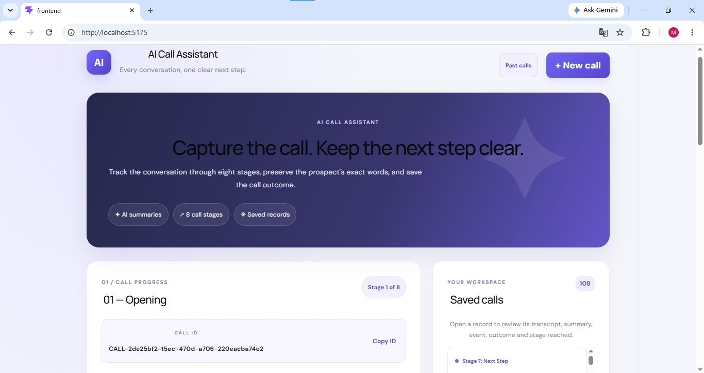
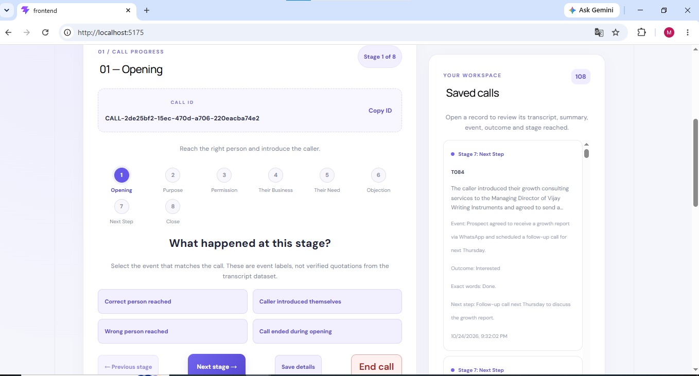

# AI Call Assistant — Intelligent Call Analysis and Tracking System

## 1. Project Overview

The **AI Call Assistant** is a web-based application designed to analyze sales and cold-call conversations using Artificial Intelligence. It processes call transcripts, generates meaningful summaries, identifies important conversation details, classifies call outcomes, and tracks the different stages of a sales conversation.

Analyzing sales calls manually can be time-consuming, especially when dealing with a large number of conversations. Important customer requirements, objections, follow-up requests, and potential sales opportunities may be difficult to identify consistently. This project addresses these challenges by combining a React-based user interface, a Node.js and Express backend, Google's Gemini AI model, and Supabase database services.

The application allows users to submit a call transcript, analyze it using AI, review the generated results, and save the analysis for future reference. Users can also update the current stage of a call and retrieve previously saved call records.

The system was tested using a dataset of 100 cold-call transcript files, providing a practical way to evaluate the application across multiple conversations.

## 2. Problem Statement

Sales teams and call analysts frequently work with large volumes of customer conversations. Manually reviewing every conversation to understand the customer's interest, identify objections, summarize discussions, and determine the next action requires considerable time and effort.

Manual analysis can also lead to inconsistent summaries, missed follow-up opportunities, and difficulty tracking conversations across different sales stages.

The objective of this project is to develop an AI-powered application that helps simplify call analysis by converting unstructured conversation transcripts into structured, readable, and actionable information.

## 3. Project Objectives

The main objectives of the AI Call Assistant are:

- **Automated Call Summarization:** Generate concise summaries of conversations using a generative AI model.
- **Conversation Stage Identification:** Identify the current stage of a sales conversation, such as Opening, Purpose, Permission, Their Business, Their Need, Objection, Next Step, or Close.
- **Customer Response Analysis:** Extract relevant information about the prospect's words and responses.
- **Outcome Classification:** Categorize calls based on their outcomes, including Interested, Callback Requested, Not Interested, No Answer, Wrong Person, Call Ended, and Other.
- **Next-Step Recommendations:** Generate a suggested next action based on the conversation.
- **Persistent Data Storage:** Store transcripts and analysis results in Supabase so users can access saved records later.
- **Call Stage Management:** Allow users to update a call's stage and associated metadata.
- **Dataset-Based Testing:** Test the backend analysis workflow using 100 cold-call transcript files.

## 4. Key Features

### 4.1 AI-Powered Transcript Analysis

Users can provide a call transcript through the web interface. The backend sends the transcript to Google's Gemini AI model for analysis and processes the model's response into structured information.

The analysis includes a summary, conversation stage, stage-related event, prospect words, call outcome, and recommended next step.

### 4.2 Intelligent Call Summaries

The application converts lengthy conversations into concise summaries that highlight the most important information. These summaries help users understand the purpose of a call and its outcome without reading the entire transcript again.

### 4.3 Sales Conversation Stage Tracking

The application supports the following stages:

1. **Opening** — Introduction and initial greeting.
2. **Purpose** — Explanation of the reason for the call.
3. **Permission** — Asking for permission to continue the conversation.
4. **Their Business** — Understanding the prospect's business or professional context.
5. **Their Need** — Identifying requirements, challenges, or potential needs.
6. **Objection** — Recognizing concerns, hesitation, or resistance.
7. **Next Step** — Discussing a follow-up, meeting, or other action.
8. **Close** — Ending the conversation.

This classification helps organize conversations and makes it easier to understand how far a sales discussion has progressed.

### 4.4 Call Outcome Classification

The system categorizes conversations into predefined outcome labels:

- Interested
- Callback Requested
- Not Interested
- No Answer
- Wrong Person
- Call Ended
- Other

These categories help users review call results consistently. The classification is AI-generated and should be checked against the original transcript when accuracy is important.

### 4.5 Recommended Next Actions

Based on the conversation, the application generates a suggested next step. Depending on the transcript, this may involve scheduling a callback, sharing additional information, arranging a meeting, addressing an objection, or closing the conversation.

The recommendation is intended to support decision-making rather than replace human judgment.

### 4.6 Database Integration

The application uses Supabase to store call transcripts and their analysis results. Saved records include information such as the transcript ID, original transcript, summary, stage, stage event, prospect words, outcome, next step, and timestamps.

The application retrieves saved calls from the backend, allowing previously analyzed conversations to remain available after the browser is refreshed.

### 4.7 Call Stage Updates

Users can update a saved call's stage through the application. The frontend sends the update to the Express backend, which processes the request and updates the corresponding database record.

This functionality supports continued tracking after the initial transcript analysis.

### 4.8 Input Validation and Error Handling

The backend checks that a transcript is provided before starting analysis. Empty input is rejected with an appropriate error message.

The application also handles AI service errors and request failures so users can identify when an analysis has not completed successfully.

## 5. Technology Stack

### Frontend
- **React.js:** Builds the interactive user interface and reusable UI components.
- **Vite:** Provides the frontend development server and build tooling.
- **JavaScript:** Implements frontend logic and communication with the backend.
- **HTML5 and CSS3:** Structure and style the user interface.

### Backend
- **Node.js:** Provides the JavaScript runtime for server-side operations.
- **Express.js:** Implements API endpoints and handles HTTP requests.
- **REST API:** Enables communication between the frontend and backend using HTTP requests.

### Artificial Intelligence
- **Google Gemini API:** Analyzes call transcripts and generates structured summaries, classifications, and suggested next actions.
- **Gemini 3.1 Flash-Lite:** The configured model used for transcript analysis.

### Database
- **Supabase:** Provides persistent storage for transcripts, summaries, call stages, outcomes, and follow-up information.

### Development and Testing Tools
- **Visual Studio Code:** Used for project development and debugging.
- **Postman or browser-based requests:** Can be used to test API endpoints.
- **Git and GitHub:** Can be used for source-code version control and project sharing.

## 6. System Architecture

The application follows a frontend–backend–database architecture.

**Step 1: User Input**

The user enters or selects a call transcript through the React frontend.

**Step 2: API Request**

The frontend sends the transcript and its identifier to the Express backend using an HTTP POST request.

**Step 3: AI Processing**

The backend sends the transcript to the Gemini API and receives an AI-generated analysis.

**Step 4: Response Processing**

The backend processes the AI response into the expected structured fields and performs validation where applicable.

**Step 5: Database Storage**

The backend saves the transcript and its analysis in Supabase. The transcript ID is used to identify the record during insert or upsert operations.

**Step 6: Results Display**

The frontend displays the generated summary, call stage, outcome, prospect-related information, and recommended next step.

**Step 7: Future Retrieval and Updates**

Users can retrieve saved call records and update a call's stage through the backend API.

This architecture separates the user interface, business logic, AI integration, and persistent storage, making the application easier to maintain and extend.

## 7. Application Workflow

Open the deployed application using the Vercel URL.

Enter a cold-call transcript or select an available transcript.

Submit the transcript for AI-powered analysis.

Review the generated summary, conversation stage, prospect words, call outcome, and recommended next step.

Verify that the call record is saved in Supabase.

Update the call stage when necessary.

Open the call history and confirm that saved records remain available after refreshing the page.

## 8. API Endpoints

The backend exposes the following endpoints.

| Method | Endpoint | Purpose |
|---|---|---|
| GET | `/health` | Checks whether the backend server is running. |
| GET | `/api/test-supabase` | Tests the backend's Supabase connectivity. |
| GET | `/api/calls` | Retrieves saved call records. |
| POST | `/api/summarize` | Analyzes a transcript and saves the resulting call information. |
| PATCH | `/api/calls/:transcriptId/stage` | Updates the stage and associated metadata for a call. |

### Transcript Analysis Request

The `/api/summarize` endpoint accepts a transcript identifier and the transcript text in the request body.

Example request structure:

```json
{
  "transcriptId": "T001",
  "transcript": "Paste the call transcript here."
}
```

The actual response structure depends on the backend implementation and the AI-generated analysis.

## 9. Database Design

The application uses a Supabase table named `calls` to maintain analyzed conversations.

Important fields include:

- `transcript_id` — Unique identifier used to associate a transcript with its analysis.
- `transcript` — Original conversation text.
- `summary` — AI-generated conversation summary.
- `stage` — Identified sales conversation stage.
- `stage_event` — Important event or activity associated with the stage.
- `prospect_words` — Relevant words or statements from the prospect.
- `outcome` — Classified call outcome.
- `next_step` — Suggested follow-up action.
- `created_at` — Record creation timestamp.
- `updated_at` — Timestamp associated with the latest update.

The database enables persistent storage and retrieval, avoiding the need to analyze the same saved transcript manually each time.

## 10. Dataset and Testing

The project was tested using a collection of **100 cold-call transcript text files**, identified from `T001` to `T100`.

A batch-processing script was created to read the transcript files and submit them to the backend analysis endpoint. The script records processing results and helps identify transcripts that require another attempt.

During testing, some requests encountered temporary AI service errors or timeouts. A separate retry script was used to retry failed transcript IDs. The final retry run reported successful processing of the remaining transcripts.

### Functional Testing

The following scenarios were tested:

- Backend server startup.
- Supabase connectivity.
- Gemini API connectivity.
- Transcript analysis through the frontend.
- Saving analysis results to Supabase.
- Retrieving saved call records.
- Preserving records after a browser refresh.
- Updating call stages through the frontend.
- Rejecting empty transcript input.
- Batch processing of the 100-transcript dataset.
- Retrying requests that failed due to temporary AI service errors.

### Testing Considerations

Successful processing means that the application completed the analysis-and-storage workflow for the submitted transcript. It does not, by itself, prove that every AI-generated summary or classification is factually correct.

The AI-generated output should be reviewed against the original transcript, especially before making important sales decisions. A formal accuracy evaluation would require manually labelled expected results and appropriate evaluation metrics.

## 11. Installation and Setup

### Prerequisites

Install the following before running the project:

- Node.js and npm.
- A Supabase project with the required `calls` table.
- A Google Gemini API key.
- Git, if version control is required.

### Step 1: Obtain the Project

Clone the repository if it has been published to GitHub:

```bash
git clone https://github.com/Bhavyasri666/AI-Call-Assistant.git
cd AI-Call-Assistant
```
Alternatively, open the existing project folder directly in Visual Studio Code.

### Step 2: Configure the Backend

Open a terminal and navigate to the backend folder:

```bash
cd backend
npm install
```

Create a `.env` file inside the `backend` folder and configure the environment variables required by `server.js`.

```env

SUPABASE_URL=your_supabase_URL
SUPABASE_SERVICE_ROLE_KEY=your_supabase_service_role_key
GEMINI_API_KEY=your_gemini_api_key
GEMINI_MODEL=gemini-3.1-flash-lite
```
Start the backend:

```bash
node server.js
```

The backend should run on port `5000` if that is the port configured in the application.

### Step 3: Start the Frontend

Open a second terminal and navigate to the frontend directory containing `package.json`.

Install the frontend dependencies:

```bash
npm install
```

Start the Vite development server:

```bash
npm run dev
```

Open the local URL printed by Vite in the terminal. In the current development setup, the frontend runs at:

`http://localhost:5175/`

### Step 4: Verify the Application

Confirm that the backend is running, the required environment variables are configured, and the database connection works. Then submit a test transcript through the frontend and verify that the analysis is displayed and saved.

If your frontend uses a configured API base URL, make sure it points to the backend server running on port `5000`.

## 12. Environment Variables and Security

The application uses environment variables to configure external services. This keeps sensitive credentials out of the source code.

Important security practices include:

- Never commit the `.env` file to a public repository.
- Add `.env`, `node_modules`, and other generated or local-only files to `.gitignore`.
- Never expose the Supabase service-role key in frontend code.
- Keep Gemini API credentials on the backend.
- Validate incoming requests before processing them.
- Configure CORS to allow only the required frontend origins when deploying.
- Avoid logging API keys or sensitive transcript content.
- Apply suitable authentication and authorization before exposing private call data publicly.

The service-role key has elevated database permissions. It should only be used in a trusted server-side environment and should never be shared publicly.

## 13. Limitations

Although the application automates important parts of call analysis, some limitations remain:

- AI-generated summaries and classifications may occasionally be inaccurate or incomplete.
- The quality of the results depends on the clarity and completeness of the transcript.
- Temporary AI service errors, rate limits, and timeouts can interrupt processing.
- Suggested next steps are recommendations and may require human review.
- Dataset processing tests verify workflow execution but do not establish a specific model accuracy score.
- Production use would require additional attention to authentication, authorization, monitoring, privacy, and scalability.

## 14. Future Enhancements

Possible future improvements include:

- Real-time call transcription using speech-to-text technology.
- Audio upload and automated transcription.
- Dashboard visualizations for call outcomes and conversation stages.
- Search, filtering, and sorting for saved calls.
- Automatic callback reminders and follow-up scheduling.
- User authentication and role-based access control.
- Exporting call reports to CSV or PDF.
- Advanced analytics for identifying common customer objections.
- Automated evaluation of AI output against manually labelled data.
- Enhanced production deployment with authentication, monitoring, improved security, and scalability.
## 15. Learning Outcomes

This project provides practical experience in full-stack web development, REST API design, generative AI integration, database connectivity, structured data processing, error handling, and dataset-based testing.

It demonstrates how a frontend application can interact with a backend service, how an AI model can transform unstructured text into structured information, and how the resulting information can be stored and retrieved using a database.

## 16. Project Conclusion

The AI Call Assistant demonstrates an approach to simplifying sales conversation analysis through generative AI and full-stack web technologies. By combining transcript summarization, call-stage identification, outcome classification, next-step suggestions, and persistent data storage, the application provides a centralized workflow for reviewing and tracking cold-call conversations.

The project also demonstrates the importance of backend validation, external API integration, database persistence, and testing with a collection of real-world-style transcript files. It can serve as a foundation for future development into a more comprehensive sales conversation management system.

## 17. Screenshots

### 1. Main Application Interface


### 2. Main Interface - Additional View


### 3. AI-Generated Call Summary


### 4. Past Call History


### 5. Supabase Query - Additional View


### 6. Call Transcript


---
## Live Demo and Repository

- **Live Application:** https://ai-call-assistant-qltudcotc-bhavya910.vercel.app/
- **Backend Health Check:** https://ai-call-assistant-x06j.onrender.com/health
- **GitHub Repository:** https://github.com/Bhavyasri666/AI-Call-Assistant
  
**Project:** AI Call Assistant  
**Category:** Full-Stack Development / Artificial Intelligence  
**Frontend:** React.js and Vite  
**Backend:** Node.js and Express.js  
**AI Integration:** Google Gemini API  
**Database:** Supabase
